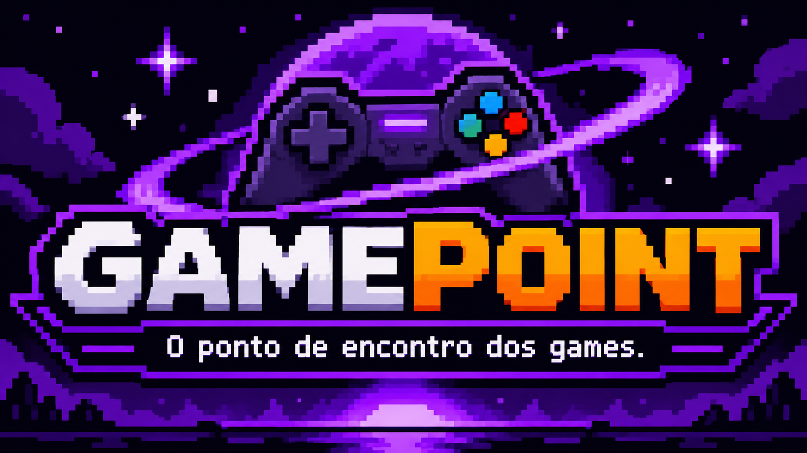

<div align="center">



# GAMEPOINT

**Reviews de jogos sem enrolação, notícias do mundo gamer e o portfólio de um streamer e desenvolvedor de jogos.**


</div>

---

## 📖 Sobre o projeto

O **GAMEPOINT** é um site estático feito do zero com **HTML, CSS e JavaScript puro**, sem frameworks e sem dependências de build. Ele reúne:

- um **catálogo de reviews** de jogos com filtro por gênero;
- a página de lançamento do jogo autoral **Ilha Quebrada**, com lista de espera;
- uma página de **notícias e rumores** do mundo dos games, alimentada por um arquivo JavaScript fácil de editar;
- uma página de **perfil/portfólio** de streamer e desenvolvedor.

O visual segue uma estética retrô/neon, com fontes *Chakra Petch* e *Nunito Sans*, fundo animado (estrelas, névoa colorida, grade neon e estrela cadente) e cards com sombra "pixelada".

---

## 🗂️ Páginas

| Página | Arquivo | Descrição |
| --- | --- | --- |
| **Jogos** | `index.html` | Catálogo de reviews com notas e filtros por gênero (Aventura, Corrida e Puzzle). |
| **Meu jogo** | `lancamento.html` | Página de divulgação de *Ilha Quebrada*, com recursos do jogo e formulário de lista de espera. |
| **Fofocas** | `noticias.html` | Notícias, lançamentos, anúncios, rumores e mercado, com filtro por tipo e destaque do dia. |
| **Perfil** | `perfil.html` | Apresentação, sobre mim, números, projetos, habilidades, lives e contato. |

---

## ✨ Funcionalidades

- 🎮 **Filtro por gênero** no catálogo, usando `data-genero` e o atributo `hidden`.
- 📰 **Notícias geradas por JavaScript** a partir de uma lista de objetos, com ordenação automática (destaque primeiro, depois as mais recentes).
- 🏷️ **Filtro por tipo de notícia**: lançamento, anúncio, rumor e mercado.
- 🔎 **Rumores com borda tracejada**, para diferenciar de anúncios oficiais.
- ✉️ **Formulário de lista de espera** (demonstração: nada é enviado de verdade).
- 🌌 **Animações de fundo** em CSS puro: estrelas piscando, névoa flutuante, chão retrô com grade neon e estrela cadente.
- 📱 **Layout responsivo**, com ajustes para telas de até 520 px, 700 px e 800 px.
- ♿ **Acessibilidade**: `aria-current`, `aria-pressed`, `aria-label`, link "Pular para o conteúdo", `:focus-visible` e respeito a `prefers-reduced-motion`.

---

## 🧱 Estrutura de arquivos

```text
GAMEPOINT/
├── index.html          # Catálogo de jogos (página inicial)
├── lancamento.html     # Página do jogo Ilha Quebrada
├── noticias.html       # Página de notícias ("Fofocas")
├── perfil.html         # Portfólio do streamer/desenvolvedor
│
├── style.css           # Estilos globais, variáveis, animações e fundo
├── noticias.css        # Estilos específicos da página de notícias
├── perfil.css          # Estilos específicos da página de perfil
│
├── script.js           # Filtro do catálogo + formulário de demonstração
├── noticias.js         # Dados das notícias, renderização e filtros
│
├── gamepoint.png       # Banner do site
├── jogo.png            # Imagem do jogo Ilha Quebrada
├── foto.jpg            # Foto do perfil
└── README.md
```

---

## 🚀 Como rodar localmente

Não há instalação nem build. Basta clonar e abrir.

```bash
# 1. Clone o repositório
git clone https://github.com/SEU-USUARIO/gamepoint.git

# 2. Entre na pasta
cd gamepoint

# 3. Abra o index.html no navegador
```

Se preferir um servidor local (recomendado), use a extensão **Live Server** do VS Code ou rode:

```bash
python -m http.server 8000
# depois acesse http://localhost:8000
```

---

## 🌐 Publicando no GitHub Pages

1. Envie o projeto para um repositório no GitHub.
2. Vá em **Settings → Pages**.
3. Em **Build and deployment**, escolha **Deploy from a branch**.
4. Selecione a branch `main` e a pasta `/ (root)` e clique em **Save**.
5. Aguarde alguns minutos: o site ficará disponível em `https://SEU-USUARIO.github.io/gamepoint/`.

---

## ✏️ Como personalizar

### Adicionar um jogo ao catálogo

Em `index.html`, copie um bloco `<article class="card">` dentro de `.grid` e ajuste o título, a descrição, o gênero e a nota. O valor de `data-genero` deve ser `aventura`, `corrida` ou `puzzle` (ou um novo gênero que você também adicionar aos botões de filtro).

```html
<article class="card" data-genero="aventura">
    <h3>Nome do Jogo</h3>
    <p>Descrição curta do jogo.</p>
    <div class="meta"><span class="tag">Aventura</span><span class="nota">★ 8,5</span></div>
</article>
```

### Atualizar as notícias

Tudo é feito em `noticias.js`:

1. Copie um bloco `{ ... }` da lista `NOTICIAS` e cole **no topo** da lista.
2. Troque título, resumo, data, fonte e link.
3. Em `categoria`, use: `lancamento`, `anuncio`, `rumor` ou `mercado`.
4. Atualize a data em `ATUALIZADO`.
5. Use `destaque: true` **somente** na notícia principal do dia.

```js
{
    titulo: "Título da notícia",
    resumo: "Resumo em palavras próprias.",
    categoria: "lancamento",   // lancamento | anuncio | rumor | mercado
    data: "2026-11-19",        // formato AAAA-MM-DD
    fonte: "Nome do site",
    url: "https://exemplo.com/materia",
    destaque: true             // opcional
}
```

> 💡 Os textos devem ser **resumos em palavras próprias**, sempre com link para a matéria original.

### Personalizar o perfil

Em `perfil.html`, procure os comentários `EDITE:` e troque:

- o link `https://www.youtube.com/@SEUCANAL` pelo link real do seu canal;
- o e-mail `seuemail@exemplo.com` pelo seu e-mail;
- os números da seção **Em números** (ou apague a seção);
- a foto `foto.jpg`.

### Mudar as cores

As cores ficam como variáveis no topo do `style.css`:

```css
:root {
    --bg: #14142b;
    --panel: #1f1f40;
    --text: #f2f0ff;
    --muted: #aaa8d0;
    --blue: #3d5afe;
    --mint: #5bf0c0;
    --pink: #ff4f9a;
    --sun: #ffd23f;
}
```

---

## 🛠️ Tecnologias

- **HTML5** semântico
- **CSS3**: variáveis, Grid, Flexbox, animações com `@keyframes`, `mask-image` e `perspective`
- **JavaScript (ES6+)**: manipulação do DOM, `dataset`, `toLocaleDateString` e filtros
- **Google Fonts**: Chakra Petch e Nunito Sans

---

## 🗺️ Próximos passos

- [ ] Conectar o formulário de lista de espera a um serviço real de e-mail
- [ ] Adicionar página individual de review para cada jogo
- [ ] Incluir busca por nome no catálogo
- [ ] Trocar os placeholders do perfil (canal e e-mail) pelos dados reais
- [ ] Publicar o site no GitHub Pages
- [ ] Lançar *Ilha Quebrada* (previsto para 2027) 🏝️

---

## 👤 Autor

**Victor**: streamer de aventura e puzzle e desenvolvedor de jogos em formação, estudante de Análise e Desenvolvimento de Sistemas.


---

## 📄 Licença

Este projeto é de uso pessoal e educacional. Defina aqui a licença de sua preferência (por exemplo, [MIT](https://choosealicense.com/licenses/mit/)) antes de tornar o repositório público.

---

<div align="center">

Feito com HTML, CSS e muita vontade de criar jogos 🎮

</div>
